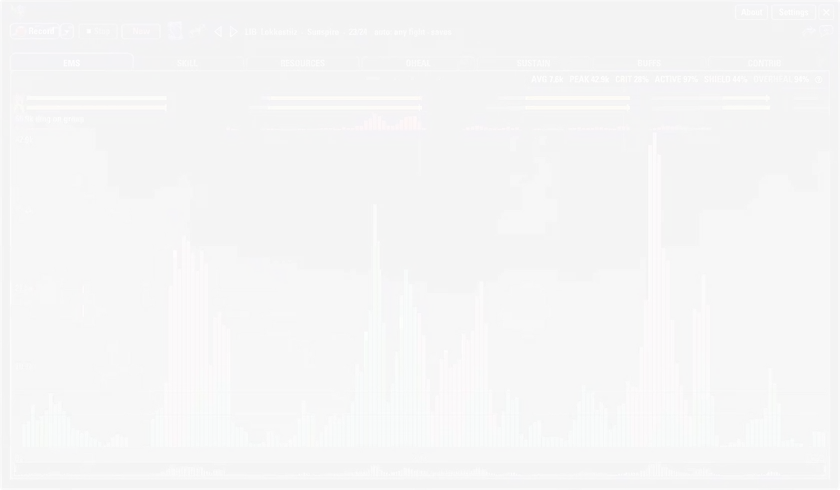
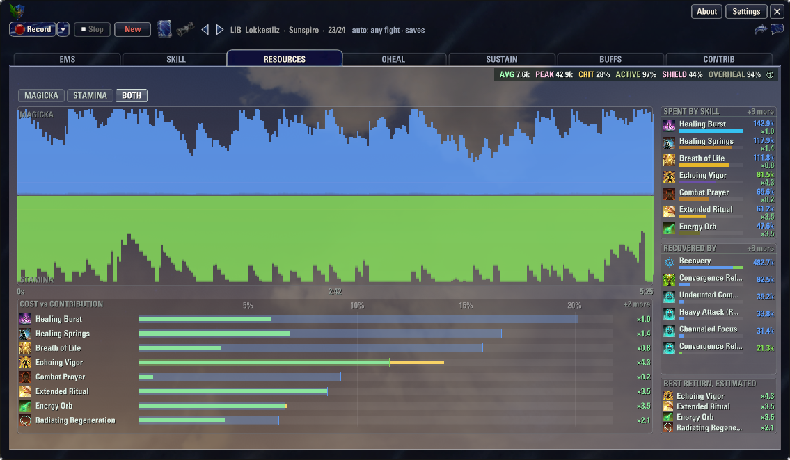
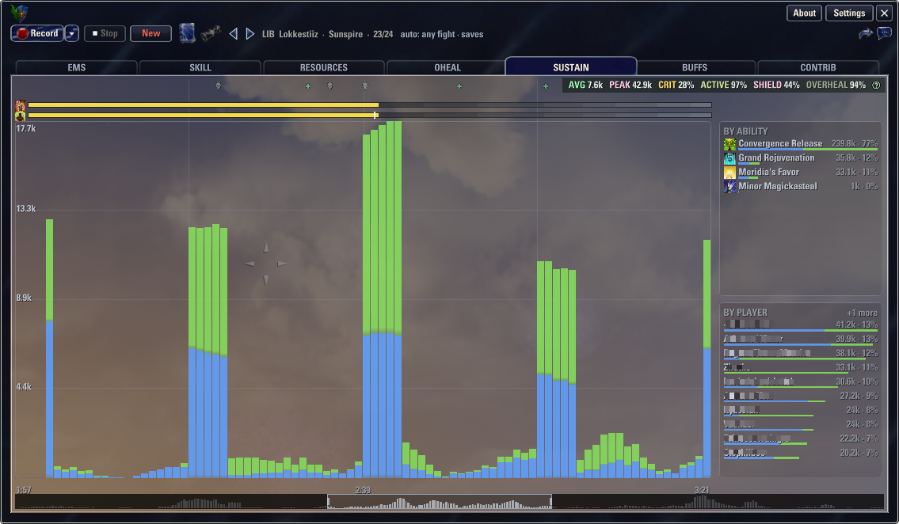
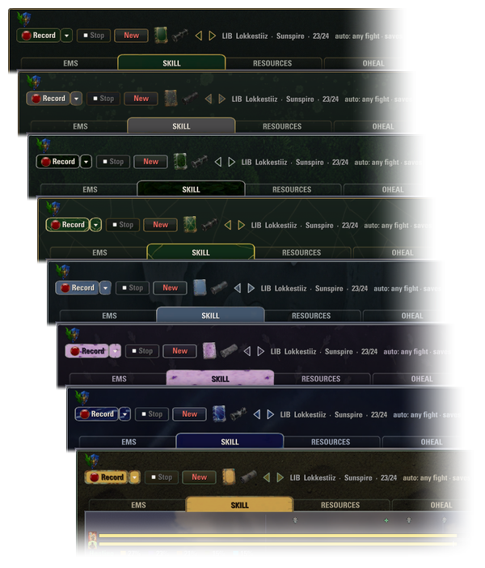

# Verdant

This is a healing analytic tool for the video game _The Elder Scrolls Online_. It works as an in-game recorder of every heal, shield, buff and similar contribution.

Record a fight and read it afterwards: what each skill healed or shielded, how much of it was wasted, what it cost, which buffs you kept up, and a couple of other things.

## In-game

Seven views of the same fight:

- **EMS**: healing and shields together, second by second, under the damage the group was taking.
- **SKILL**: the same bars split by where each heal and each shield came from.
- **RESOURCES**: your magicka and stamina over the whole fight, what each skill cost and what it gave back.
- **OHEAL**: the healing that landed against the healing that was wasted.
- **SUSTAIN**: the magicka and stamina you restored to the group, by ability and by player.
- **BUFFS**: the buffs you kept up, on whom and for how long.
- **CONTRIB**: every skill ranked by what it healed or shielded in the whole recording.

Eight themes, picked in Settings:

## Install

Download from [ESOUI](https://www.esoui.com/downloads/info4557-Verdant.html), or from the releases of this repository, and extract into `Documents/Elder Scrolls Online/live/AddOns/`.

Verdant has no dependencies.

## Where the ideas come from

Verdant was written with the help of a coding agent. The ideas below reached the code through it and through me, and none of them is ours, so their authors are named here. Links go to the authors' own copies where one exists; the rest point to the publisher.

- The chart never draws more pieces than it has pixel columns, and each column keeps its peak instead of an average, after Jugel, Jerzak, Hackenbroich & Markl, [*M4: A Visualization-Oriented Time Series Data Aggregation*](https://www.vldb.org/pvldb/vol7/p797-jugel.pdf) (Proceedings of the VLDB Endowment, 2014).
- The strip under a stopped chart, with the whole fight in small and a frame over the part on screen, is the overview and detail interface of Cockburn, Karlson & Bederson, [*A review of overview+detail, zooming, and focus+context interfaces*](https://www.microsoft.com/en-us/research/wp-content/uploads/2008/01/cockburn-ComputingSurveys09.pdf) (ACM Computing Surveys, 2009).
- RESOURCES reads each pool as a stock with an inflow and an outflow, the way Forrester does in [*Industrial Dynamics*](https://lccn.loc.gov/61017871) (MIT Press, 1961), Meadows in [*Thinking in Systems*](https://www.chelseagreen.com/product/thinking-in-systems/) (Chelsea Green, 2008) and Sterman in [*Business Dynamics*](https://mitmgmtfaculty.mit.edu/jsterman/business-dynamics) (Irwin/McGraw-Hill, 2000).
- Its two pools hang off one midline and its lists are ranked bars because of Cleveland & McGill, [*Graphical Perception*](https://doi.org/10.1080/01621459.1984.10478080) (JASA, 1984), and Bertin, [*Semiology of Graphics*](https://www.esri.com/en-us/esri-press/browse/semiology-of-graphics-diagrams-networks-maps) (1967; Esri Press, 2010).
- The performance rules, nothing allocated while a fight is recorded and pools of a fixed size, follow Holzmann, [*The Power of 10*](https://spinroot.com/gerard/pdf/P10.pdf) (IEEE Computer, 2006), Ierusalimschy, [*Lua Performance Tips*](https://www.lua.org/gems/sample.pdf) (Lua Programming Gems, 2008) and Nystrom, [*Game Programming Patterns*](https://gameprogrammingpatterns.com/object-pool.html) (2014).
- The checks that run in a debug build and cost nothing in a release take their shape from the [validation layers](https://docs.vulkan.org/guide/latest/validation_overview.html) of Vulkan (Khronos). This one was more of a personal inspiration, from my own use of it, but I still think it is worth mentioning.
- The game is reached through one layer and nothing else touches it: the anticorruption layer of Evans, [*Domain-Driven Design*](https://www.informit.com/store/domain-driven-design-tackling-complexity-in-the-heart-9780321125217) (Addison-Wesley, 2003), in the arrangement of Cockburn, [*Hexagonal architecture*](https://alistair.cockburn.us/hexagonal-architecture/) (2005) and Martin, [*The Clean Architecture*](https://blog.cleancoder.com/uncle-bob/2012/08/13/the-clean-architecture.html) (2012). The modules are cut by the decision each one hides, after Parnas, [*On the criteria to be used in decomposing systems into modules*](https://doi.org/10.1145/361598.361623) (Communications of the ACM, 1972).
- Every failure has a code, a count and a defined answer, after Leveson, [*Engineering a Safer World*](https://doi.org/10.7551/mitpress/8179.001.0001) (MIT Press, 2012).
- What the add-on believes about the game is written down as rules that a recorded fight can refute, before the code, after Lamport, [*Specifying Systems*](https://lamport.azurewebsites.net/tla/book.html) (Addison-Wesley, 2002). Each change is then tried against planted faults, a practice that goes back to DeMillo, Lipton & Sayward, [*Hints on Test Data Selection*](https://doi.org/10.1109/C-M.1978.218136) (IEEE Computer, 1978).
- The category of a heal that arrives under the id of a tick comes from the game's own ability data. Its record layout is documented by the UESP in [*ESO Mod:Skill Data Format*](https://en.uesp.net/wiki/ESO_Mod:Skill_Data_Format), the files are read with the UESP's [EsoExtractData](https://en.uesp.net/wiki/ESO_Mod:EsoExtractData), and the layout is kept current by [sheumais](https://github.com/sheumais)'s [ESO ID Dictionary](https://github.com/sheumais/esoiddictionary) project.
- LibCombat, by Solinur, shares no code with Verdant, but the way it handles the game's combat events informed ours. Thank you so much for your work.

Thank you to all the giants who inspired this project and helped to build it.

## License and contributing

Published under the [Verdant License](LICENSE): use it and change your own copy; do not redistribute it or publish an add-on made from it.

Contributions are welcome and credited. Write to me first: open an issue.

___

_This Add-on is not created by, affiliated with, or sponsored by ZeniMax Media Inc. or its affiliates. The Elder Scrolls® and related logos are registered trademarks or trademarks of ZeniMax Media Inc. in the United States and/or other countries. All rights reserved._
